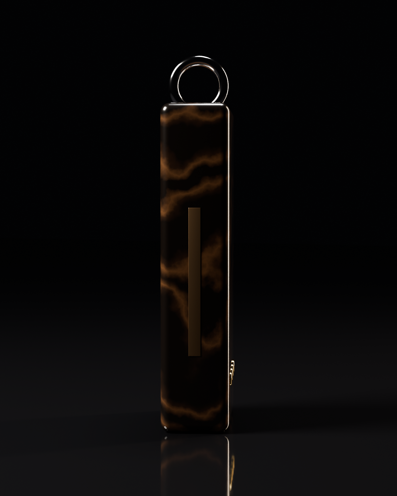
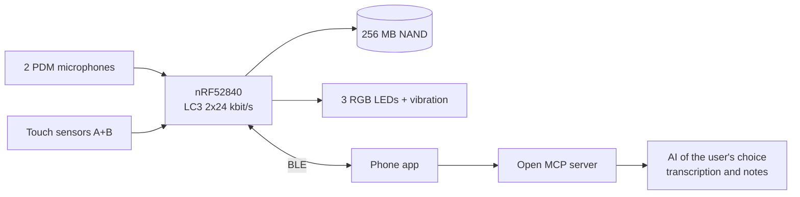

# notªpad

**A DIY wearable AI voice recorder: a resin monolith you wear around your neck. It records your day and leaves transcription and note-taking to the AI of your choice, through an open MCP server.**

### [▶ Live animated presentation](https://pzero.github.io/notapad/)

## Contents
- [Overview](#overview)
- [The object](#the-object)
- [Architecture](#architecture)
- [Electronics v0.1](#electronics-v01)
- [Manufacturing](#manufacturing)
- [Status and roadmap](#status-and-roadmap)
- [Project history](#project-history)
- [Repository layout](#repository-layout)
- [Contributing](#contributing)
- [License](#license)
- [Authors](#authors)

## Overview
notªpad is a wearable recorder in the spirit of Plaud and Omi, but open. It records all day, syncs over Bluetooth LE with a phone, and hands the audio to an **open MCP server**: transcription, summaries and note organisation are done by the AI the user picks, not by a closed service.

Design goals:
- **Own your data.** Audio and notes stay with the user; the AI is a replaceable component.
- **No screen, no app to open.** Interaction is a squeeze gesture, three LEDs and a vibration motor.
- **Buildable by a small team.** Off-the-shelf parts (an Ebyte E73 nRF52840 module), a 4-layer board assembled by JLCPCB, a resin shell cast in a silicone mould.

> Honest status: this is a design in progress. Nothing has been manufactured or tested yet. Figures such as runtime and capacity are estimates.

## The object
| | |
|---|---|
| Size | about 41 × 17.5 × 8 mm (fallback 9 mm; thickness may grow 1 to 2 mm for a larger battery), cast resin |
| Attachment | steel ring cast in with a bushing, so it cannot come off |
| Controls | touch sensors on **both** sides (metal strips as electrodes); a touch counts only when both are active (the "squeeze" gesture), to avoid accidental triggers from the chest |
| Signalling | 3 RGB LEDs behind a 10 mm front slit, vibration motor |
| Audio | 2 PDM microphones: one on the front face, one on the top face next to the ring (via a small channel) |
| Contacts | 4 exposed gold contacts on the back: 5V, GND (charging), SWDIO, SWCLK (firmware over cable in v0.1, later also OTA over BLE). They are also a deliberate aesthetic feature. Pogo pins live in the dock, not on the monolith |

| Back | Side | Finish options |
|---|---|---|
|  |  |  |

## Architecture

The app and the MCP server are not started yet (see the roadmap).

## Electronics v0.1
- **Module:** Ebyte E73-2G4M08S1C (nRF52840), wire antenna at the board edge with keep-out.
- **Storage:** W25N02KV QSPI NAND, 256 MB (about 10 to 11 h of stereo LC3 audio).
- **Microphones:** 2x MSM261DGT003 (top-port PDM), stereo on a single data line (L/R pin tied low on one, high on the other).
- **Power:** ~60 mAh LiPo with protection circuit, MCP73831 charger at 50 mA, 3.3 V LDO, and a P-MOSFET latch that disconnects everything when the battery reaches 3.50 V (idle draw below ~5 uA). The 5V contact re-arms the latch and resets the MCU ("reset by putting it on charge"). A watchdog is always on.
- **Board:** 16.5 x 38 mm, 4 layers, 1.0 mm, ENIG or lead-free HASL (to be fixed at order), components on the top side only. Stackup: F.Cu signals, In1 continuous GND, In2 signals and power, B.Cu signals and GND; antenna keep-out on all layers. Zones: A (0-7 mm: pins, microphone, charger, latch), B (7-20 mm: LEDs, touch ICs, LDO, passives), C (20-38 mm: E73 module and antenna). The motor and battery sit under the board.
- **Battery:** the 60 mAh figure is for the cell planned so far. A 502025 cell does not fit; a 501520 (5 x 15 x 20 mm, roughly 80 to 100 mAh, estimate) is the candidate, still to be confirmed.
- **Estimated consumption:** about 4.6 mA average, about 11.5 h on 60 mAh.

### What changed during design review (21 Nov 2026)
- **Pinout redone.** The E73 does not expose P0.11, P0.14, P0.16, P0.19, P0.21, P0.23, P0.25, P0.27 and P1.01, which the first pinout used. The new assignment is in [`docs/pinout_v0.1.md`](docs/pinout_v0.1.md); the 32 kHz crystal is dropped (firmware uses the internal LFRC).
- **Microphones replaced.** The first choice (LMD3526B261) is bottom-port; the MSM261DGT003 is top-port and in stock at JLCPCB.
- **Space savings.** One resistor per LED on the common anode instead of one per colour (LEDs multiplexed, one colour at a time); an extra 1 uF capacitor on the latch so a reset at low battery does not power the device off.
- **Board closed on 4 layers.** With 2 layers 7 connections stayed open; JLCPCB Economic assembly does not accept 4 layers at 0.8 mm, so the board is 1.0 mm. Length fixed at 38 mm (at 35 mm 4 connections stayed open). Checks: ERC 0, DRC 0 violations, 0 unconnected, schematic-board parity 0.
- **Charger changed to MCP73831** (50 mA), the same part as a sister project, so one extra-fee component is shared in a combined panel.
- **Manufacturing route fixed (late 21 Nov).** JLCPCB only. The XIAO carrier variant costs more than the E73 module, is 17.5 mm wide (as wide as the monolith) and has 13 GPIOs against about 20 needed; home assembly dropped (no hot plate or paste), so JLCPCB assembles every board. No distributor beats LCSC/JLCPCB for the key chips, and a Basic-parts-only board is impossible (no BLE, NAND, PDM microphones, RGB LEDs or touch ICs in that library); 7 extra-fee parts stay. Q2 stays a dual 2N7002DW; NAND and charger stay extra-fee parts.
- **Parts review.** E73 variant with only an external-antenna socket rejected; the 256 MB NAND confirmed after comparing alternatives; microphones rotated by 180 degrees in the JLCPCB placement file (checked in their preview). A NextPCB variant was prepared and dropped for v0 (no microphone stock, higher quote).
- **Charger stays on the monolith** (not in the dock): unpowered contacts outside the dock, CHRG signal available, full 4.2 V charge.

Documents: pinout in [`docs/pinout_v0.1.md`](docs/pinout_v0.1.md); bill of materials and netlist in [`jlc/`](jlc/); KiCad project and generators in [`kicad/`](kicad/).

## Manufacturing
- **PCB and assembly (v0):** JLCPCB only. Economic PCBA, 4 layers, 1.0 mm, 5 bare boards, 2 assembled; quote 97 EUR for the 2 assembled boards, shipped (estimate until the order is placed). The E73 module was out of stock, so 2 units are pre-ordered into the JLCPCB warehouse; the board order follows their arrival. Production files are generated by script in [`kicad/fab_out/`](kicad/fab_out/).
- **Later batches:** also assembled by JLCPCB (home assembly dropped: no hot plate or paste). Component cost is estimated at about 19 USD per monolith, mostly NAND and module.
- **First programming:** SWD from a Raspberry Pi with OpenOCD (or a Pico debugprobe); the nRF52840 has no ROM bootloader, so the first bootloader goes in over SWD, then updates are OTA over BLE.
- **Shell v0.1:** two SLA half-shells (JLC3DP) filled with low-exotherm epoxy, since JLC does not cast around electronics.
- **Final shell:** SLA master, silicone mould, fully cast pigmented resin.

## Status and roadmap
**Done**
- Concept, finish renders, animated presentation, BOM and netlist for v0.1.
- Datasheet checks (E73 pinout, microphone port) and the resulting corrections above.
- v0.1 board closed in KiCad: 4 layers, 1.0 mm, 16.5 x 38 mm; ERC 0, DRC 0, no unconnected nets.
- Production files for JLCPCB, PCBWay and ALLPCB in `kicad/fab_out/`.
- Charger changed to MCP73831; E73 socket-only variant rejected; NAND confirmed; purchase plan drafted.
- Manufacturing route fixed: JLCPCB only, quote 97 EUR for 2 fully assembled and shipped boards (Economic PCBA, 5 bare boards, 2 assembled). Alternatives dropped: PCBWay, ALLPCB, NextPCB, a Seeed XIAO carrier variant and home assembly.

**In progress**
- Waiting for the E73 module: it was out of stock at JLCPCB, so 2 units were pre-ordered through its parts manager to sit in the JLCPCB warehouse. The board order is placed once they arrive (a Black Friday coupon runs until 2 December; timing is not a promise).
- Parts outside JLCPCB: shopping list in `acquisti/spesa_amazon.md` (501520 LiPo candidate, roughly 80 to 100 mAh, an estimate; 0820 coin vibration motor; small epoxy kit; optional SWD probe and magnetic pogo connector), estimated 40 to 60 EUR; whole v0 about 140 to 170 EUR (estimates).

**Next**
1. Buy battery, motor and resin; design the two SLA half-shells for JLC3DP.
2. Bring-up when the boards arrive: power rails, SWD, LEDs, microphones, NAND and touch.
3. Build the charging base.

**On hold by choice (restart after the board)**
- Firmware on a XIAO nRF52840 (same chip): recording, LC3, NAND, BLE sync.
- Phone app (proposal: Flutter, Android first) and the MCP server.

Working notes (in Italian): [`docs/STATO.md`](docs/STATO.md), [`docs/DECISIONI.md`](docs/DECISIONI.md), [`docs/DOMANDE-APERTE.md`](docs/DOMANDE-APERTE.md).

## Project history
Latest milestones (full timeline on the [presentation page](https://pzero.github.io/notapad/#history)), all on 21 Nov 2026:
1. Manufacturing route fixed: JLCPCB only, 97 EUR quoted for 2 assembled boards; E73 module pre-ordered into the JLCPCB warehouse; shopping list for outside parts.
2. [Purchasing plan, production files and public docs update added](https://github.com/PZero/notapad/commit/e134c4fe3421e4ed552cf2a572049745e943e3e5).
3. [Microphone stock issue noted, part verified on its datasheet](https://github.com/PZero/notapad/commit/ab7805fa6c689fa76aa890e7f2c9aea123181f45).
4. [E73 socket-only variant rejected, module stock issue noted](https://github.com/PZero/notapad/commit/082cf999c373edec3fcccc1b11ad9b18bd77741e).
5. [Board v0.1 moved to 4 layers and closed, production files added](https://github.com/PZero/notapad/commit/9f1f8bed521b04b1bb8905c710e02cd58c6ed17a).

## Repository layout
| Path | Contents |
|---|---|
| `docs/` | project state, decisions, open questions, pinout (working documents, in Italian) |
| `jlc/` | bill of materials, netlist, board outline DXF, generator script |
| `kicad/` | KiCad project, LCSC-derived library, generation and routing scripts |
| `render/` | monolith renders and the script that makes them |
| `pagina/` | animated presentation (three.js), published on GitHub Pages |
| `.claude/` | project agents and commands used to keep documents in sync |
| `CHANGELOG.md` | change history |

## Contributing
Issues and ideas are welcome, especially on the electronics review, enclosure casting and the MCP server design. Please open an issue before a large change. Working documents are in Italian; the README, presentation and changelog are in English.

## License
To be decided. Until a license is added, all rights are reserved by the authors.

## Authors
Two friends, as a hobby project.
