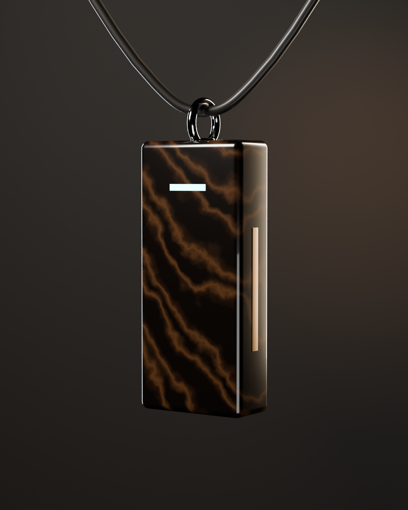
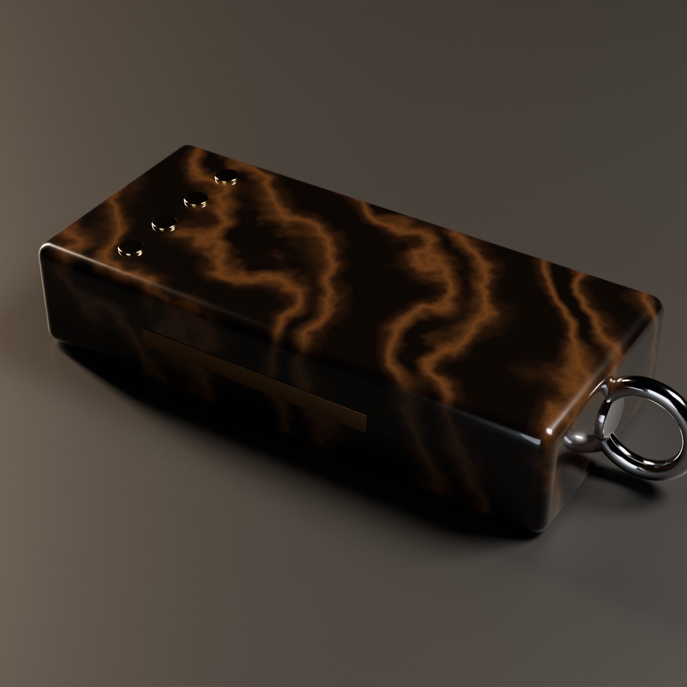
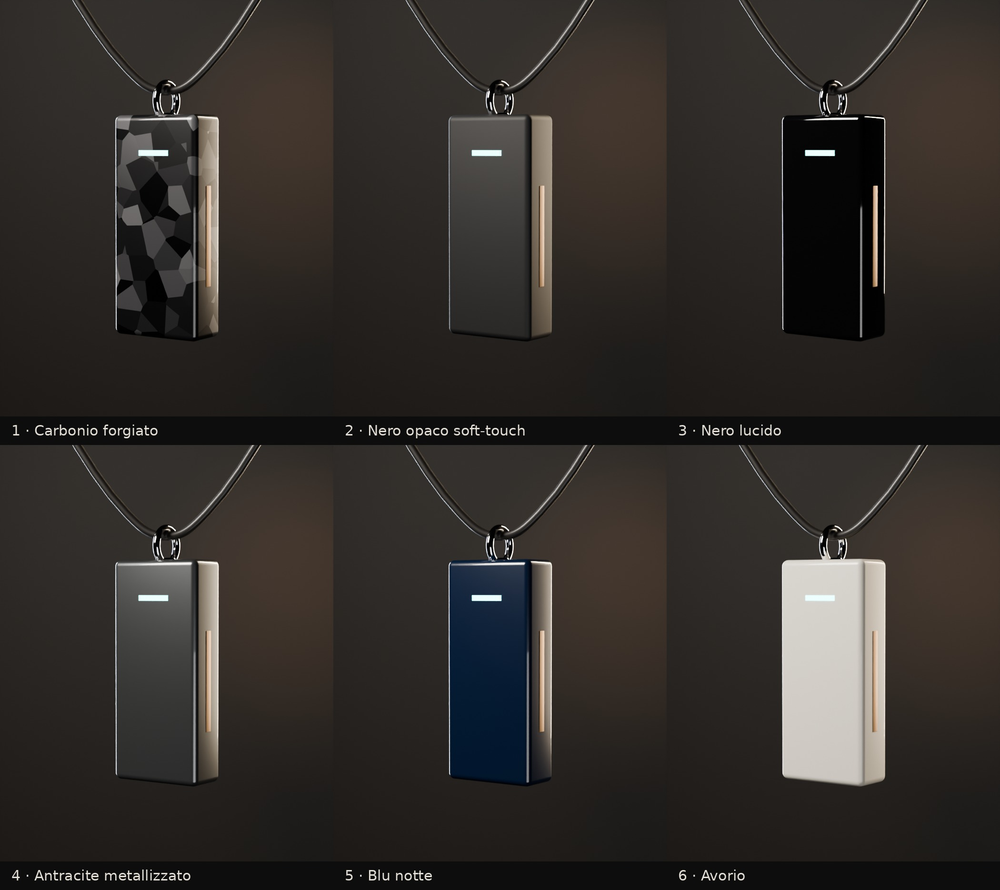
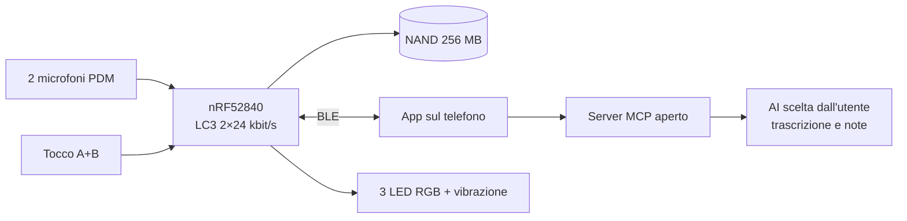

# notªpad

**Registratore AI indossabile fai-da-te: un monolite di resina da portare al collo che registra la giornata e affida trascrizione e note all'AI che scegli tu.**

> Stato: **v0.1 in progettazione**. Scheda in KiCad, verso il primo ordine JLCPCB. Firmware e app non ancora iniziati.

## Indice
- [Panoramica](#panoramica)
- [L'oggetto](#loggetto)
- [Architettura](#architettura)
- [Elettronica v0.1](#elettronica-v01)
- [Produzione](#produzione)
- [Struttura delle cartelle](#struttura-delle-cartelle)
- [Roadmap](#roadmap)

## Panoramica
notªpad è un registratore indossabile nello stile di Plaud e Omi, ma aperto. Registra tutto il giorno, si sincronizza via Bluetooth con il telefono e passa l'audio a un **server MCP aperto**: trascrizione, riassunti e organizzazione delle note li fa l'AI scelta dall'utente, non un servizio chiuso.

## L'oggetto
| | |
|---|---|
| Dimensioni | 38 × 17,5 × 8 mm (fallback 9 mm), resina colata |
| Aggancio | anello in acciaio annegato con boccola |
| Comandi | tocco su entrambi i fianchi (gesto "stretta": valgono solo insieme) |
| Segnali | 3 LED RGB dietro una fessura frontale da 10 mm, motorino di vibrazione |
| Audio | 2 microfoni PDM top-port: uno frontale, uno verso la faccia superiore |
| Contatti | 4 contatti dorati sul retro: 5V, GND (ricarica), SWDIO, SWCLK (firmware) |

| Retro | Fianco | Varianti di finitura |
|---|---|---|
|  |  |  |

## Architettura

## Elettronica v0.1
- **Modulo** Ebyte E73-2G4M08S1C (nRF52840) con antenna a filo del bordo.
- **Memoria** W25N02KV, NAND QSPI da 256 MB (circa 10 h di audio stereo).
- **Microfoni** 2× MSM261DGT003, PDM top-port, in stereo su un solo filo dati.
- **Alimentazione** LiPo circa 60 mAh con PCM, caricatore TP4054 a 50 mA, LDO 3,3 V, latch a P-MOSFET che stacca tutto sotto 3,50 V (consumo a riposo < 5 µA); il 5V della basetta riaccende e resetta.
- **Autonomia stimata** circa 11,5 h (4,6 mA medi).
- Scheda 16,5 × 35 mm, 2 strati, 0,8 mm, componenti solo sul lato superiore.

Documenti: pinout in [docs/pinout_v0.1.md](docs/pinout_v0.1.md), distinta e collegamenti in [jlc/](jlc/), progetto KiCad e generatori in [kicad/](kicad/).

## Produzione
- PCB e montaggio: JLCPCB Economic PCBA (2 schede montate su 5).
- Prima programmazione via SWD (Raspberry Pi + OpenOCD o sonda Pico), poi aggiornamenti via Bluetooth.
- Guscio v0.1: due mezzi gusci SLA + riempimento epossidico. Versione finale: master SLA → stampo in silicone → colata piena pigmentata.

## Struttura delle cartelle
| Cartella | Contenuto |
|---|---|
| `docs/` | stato, decisioni, domande aperte, pinout |
| `jlc/` | distinta, collegamenti, contorno DXF, generatore |
| `kicad/` | progetto KiCad, libreria LCSC, script di generazione e sbroglio |
| `render/` | render del monolite e script |
| `pagina/` | pagina di presentazione animata |

## Roadmap
1. Scheda v0.1: sbroglio, DRC, preventivo e ordine JLC.
2. Firmware su XIAO nRF52840 (Zephyr): registrazione, LC3, NAND, sincronizzazione BLE.
3. App (proposta: Flutter, prima Android) e server MCP.
4. Guscio in resina e prove indossate.

## Autori
Progetto di Fabio e di un amico, a Genova.
