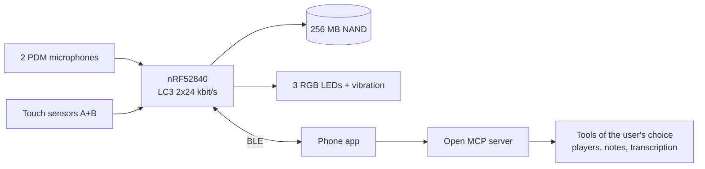
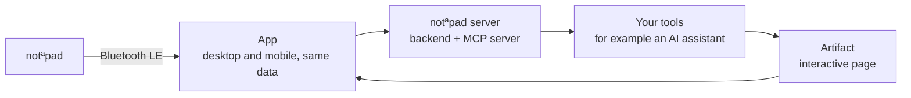
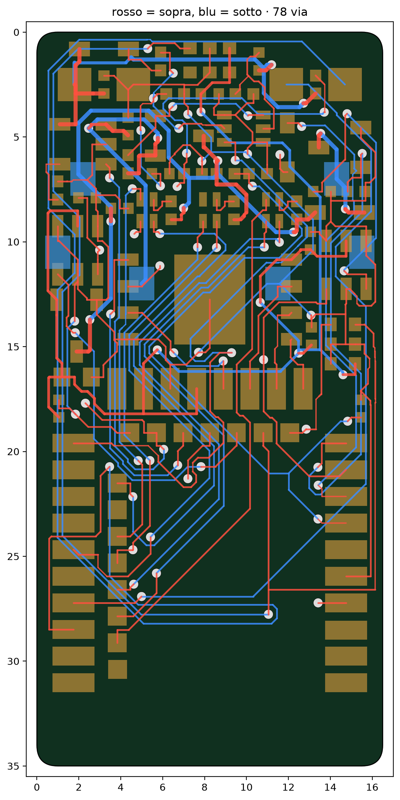
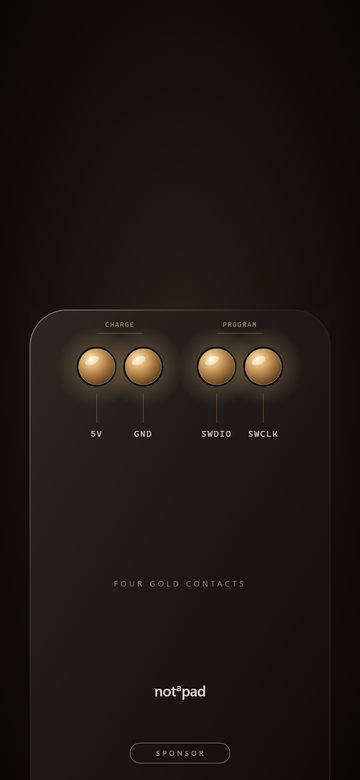
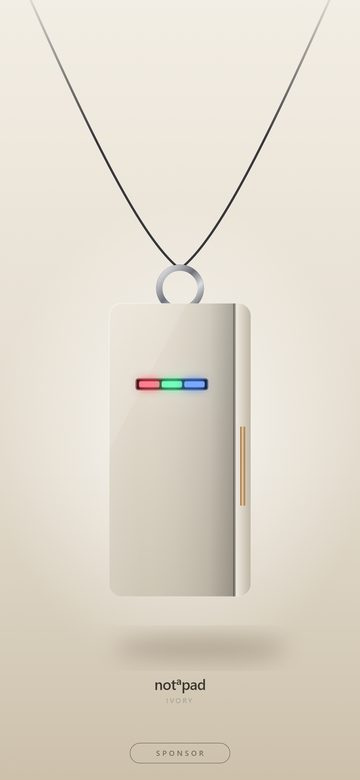
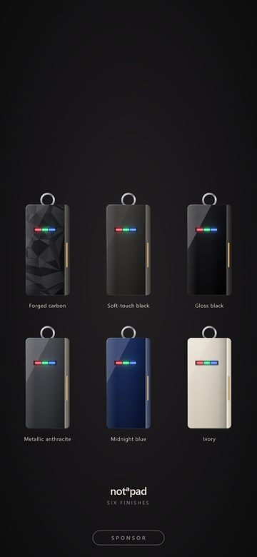
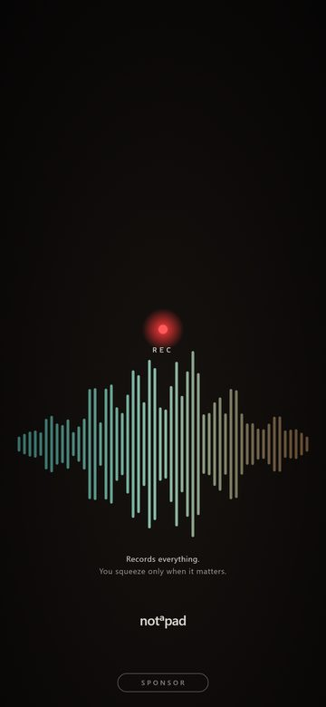

# notªpad

**An open wearable voice recorder with an open data layer. It records all day and keeps your recordings on devices you own; open, documented interfaces (files, JSON and an MCP server) let you choose which tools use them. A resin monolith you wear around your neck.**

 

  

### [▶ Live animated presentation](https://pzero.github.io/notapad/)

**Follow the build:** [Instagram](https://www.instagram.com/notapadlabs/) · [YouTube](https://www.youtube.com/@notapadlabs) · [TikTok](https://www.tiktok.com/@notapadlabs) · **Support it:** [Ko-fi](https://ko-fi.com/notapad)

## Contents
- [Overview](#overview)
- [The object](#the-object)
- [Architecture](#architecture)
- [How it works (planned)](#how-it-works-planned)
- [Electronics v0.1](#electronics-v01)
- [Pre-order verification](#pre-order-verification)
- [First firmware and app tests](#first-firmware-and-app-tests)
- [Test bench: exploration now, MCP server later](#test-bench-exploration-now-mcp-server-later)
- [Wallpapers](#wallpapers)
- [Manufacturing](#manufacturing)
- [Status and roadmap](#status-and-roadmap)
- [Support the project](#support-the-project)
- [Project history](#project-history)
- [Repository layout](#repository-layout)
- [Contributing](#contributing)
- [License](#license)
- [Authors](#authors)

## Overview
notªpad is a wearable recorder in the spirit of Plaud and Omi, but open. Two things set it apart: **continuous recording all day** and an **open MCP server**. It records all day, syncs over Bluetooth LE with a phone, and hands the audio to an **open MCP server**. The device itself only records: what happens next (playback, search, transcription, notes) is up to the tools the user picks, not a closed service.

Design goals:
- **Own your data.** Audio and notes stay with the user; every tool that reads them is replaceable.
- **No screen, no app to open.** Interaction is a squeeze gesture, three LEDs and a vibration motor.
- **Buildable by a small team.** Off-the-shelf parts (an Ebyte E73 nRF52840 module), a 4-layer board assembled by a PCBA service, a resin shell cast in a silicone mould.

> Honest status: this is a design in progress. Nothing has been manufactured yet; the first firmware and app tests (on a development board) have run on a development board (connection, recording, download and transcription work; deeper tests are pending). Figures such as runtime and capacity are estimates.

## The object
| | |
|---|---|
| Size | about 41 × 17.5 × 9 mm (it was 8 mm until 22 Nov; 38 mm is the board length), cast resin |
| Attachment | steel ring cast in with a bushing, so it cannot come off |
| Controls | touch sensors on **both** sides (metal strips as electrodes); a touch counts only when both are active (the "squeeze" gesture), to avoid accidental triggers from the chest |
| Signalling | 3 RGB LEDs behind a 10 mm front slit, vibration motor |
| Audio | 2 PDM microphones: one on the front face, one on the top face next to the ring (via a small channel) |
| Contacts | 4 exposed gold contacts on the back: 5V, GND (charging), SWDIO, SWCLK (firmware over cable in v0.1, later also OTA over BLE). They are also a deliberate aesthetic feature. Pogo pins live in the dock, not on the monolith |

| Back | Side | Finish options |
|---|---|---|
|  |  |  |

## Architecture

The real app and the MCP server are not started yet; a test app for a development board exists (see the roadmap).

### How it works (planned)
Next / planned, defined on 25 Nov 2026 and not built yet. It is a loop, and day to day you only use the app. The animated version is on the [presentation page](https://pzero.github.io/notapad/#how).

1. The notªpad syncs its audio to the app; the app sends transcripts to the notªpad server.
2. The server is only a go-between (backend plus an open MCP server). Raw transcripts go to the user's own AI and are then deleted from the server; the data stays the user's. The server could also be self-hosted.
3. The AI of the user's choice runs a preset agent template: it splits the day into segments, summarises, links and shows.
4. The result is an interactive artifact, shown back in the app.

**Voice commands and integrations.** Working today in the test app: a spoken "Command, turn on the kitchen light" turns on a light (the test app calls Home Assistant directly). Next / planned: through MCP, the user's AI could act on other tools (calendar, tasks, notes, files, any MCP server).

## Electronics v0.1
- **Module:** Ebyte E73-2G4M08S1C (nRF52840), wire antenna at the board edge with keep-out.
- **Storage:** W25N02KV QSPI NAND, 256 MB (about 10 to 11 h of stereo LC3 audio).
- **Microphones:** the front one is an MSM261DGT006 (top-port PDM). On 25 Nov it replaced the MSM261DGT003 with the updated version indicated by its manufacturer; footprint and pinout still to be confirmed against the datasheet. Since 24 Nov the top one is a Vesper VM3011, a PDM microphone with acoustic wake-up: it listens with the clock stopped at about 10 uA (datasheet figure, preliminary) and wakes the processor when sound passes a self-adapting threshold. Stereo on a single data line.
- **Motion and sound emitter (24 Nov):** a 3-axis accelerometer (LIS2DH12, I2C) and a 4 x 4 mm magnetic buzzer on the back, driven by the second half of a dual MOSFET shared with the vibration motor. The joint Apple/Google specification against unwanted tracking (DULT) asks for a sound emitter (at least 60 phon at 25 cm) and recommends a motion sensor. **This is hardware preparation only, not compatibility:** Google requires registration and certification, and Apple requires its MFi programme, whose specifications are not public.
- **Power:** ~110 mAh LiPo (381620 candidate) with protection circuit, MCP73832 charger at 50 mA, 3.3 V LDO, and a P-MOSFET latch that disconnects everything when the battery reaches 3.50 V (idle draw below ~5 uA). The 5V contact re-arms the latch, goes directly to the nRF52840 VBUS pin (internal detection; the charger status read was dropped to free pins) and resets the MCU ("reset by putting it on charge"). A watchdog is always on.
- **Board:** 16.5 x 38 mm, 4 layers, 1.0 mm, ENIG or lead-free HASL (to be fixed at order), components on the top side only. Stackup: F.Cu signals, In1 continuous GND, In2 signals and power, B.Cu signals and GND; antenna keep-out on all layers. Zones: A (0-7 mm: pins, top microphone, charger, latch), B (7-20 mm: LEDs, touch ICs, LDO, passives), C (20-38 mm: E73 module and antenna). The motor and battery sit under the board.
- **Battery:** the 502025, 602030, 401020, 401230 and 402020 cells were ruled out (too wide, too long or too small). The candidate is the 381620 (3.8 x 16 x 20 mm, about 110 mAh, estimate from listings), with protection still to be confirmed; the 501520 does not fit the 9 mm monolith.
- **Estimated consumption:** about 4.6 mA average while recording, so about 20 h on the 110 mAh cell (estimate from datasheets, little margin without the DC-DC converter; to be measured). Memory, not battery, sets the limit for continuous recording: about 11 to 12 h of stereo audio in 256 MB, stretched by recording only when there is sound and by syncing during the day.

### What changed during design review (21 Nov 2026)
- **Pinout redone.** The E73 does not expose P0.11, P0.14, P0.16, P0.19, P0.21, P0.23, P0.25, P0.27 and P1.01, which the first pinout used. The new assignment is in [`docs/pinout_v0.1.md`](docs/pinout_v0.1.md); the 32 kHz crystal is dropped (firmware uses the internal LFRC).
- **Microphones replaced.** The first choice (LMD3526B261) is bottom-port; the MSM261DGT003 is top-port and in stock (replaced on 25 Nov by the updated MSM261DGT006, see the update below).
- **Space savings.** One resistor per LED on the common anode instead of one per colour (LEDs multiplexed, one colour at a time); an extra 1 uF capacitor on the latch so a reset at low battery does not power the device off.
- **Board closed on 4 layers.** With 2 layers 7 connections stayed open; the economy assembly tier does not accept 4 layers at 0.8 mm, so the board is 1.0 mm. Length fixed at 38 mm (at 35 mm 4 connections stayed open). Checks: ERC 0, DRC 0 violations, 0 unconnected, schematic-board parity 0.
- **Charger changed to MCP73831** (50 mA), chosen at the time to keep the number of extra-fee components down. *Superseded on 22 Nov by the MCP73832, see the pre-order verification below.*
- **Manufacturing route first fixed (late 21 Nov).** The XIAO carrier variant costs more than the E73 module, is 17.5 mm wide (as wide as the monolith) and has 13 GPIOs against about 20 needed; home assembly dropped (no hot plate or paste), so a PCBA service assembles every board. No distributor beats the one we use for the key chips, and a Basic-parts-only board is impossible (no BLE, NAND, PDM microphones, RGB LEDs or touch ICs in that library); 7 extra-fee parts stay. Q2 stays a dual 2N7002DW; NAND and charger stay extra-fee parts.
- **Parts review.** E73 variant with only an external-antenna socket rejected; the 256 MB NAND confirmed after comparing alternatives; microphones rotated by 180 degrees in the placement file (checked in the assembler's preview). An alternative manufacturing variant was prepared and dropped for v0 (no microphone stock, higher quote).
- **Charger stays on the monolith** (not in the dock): unpowered contacts outside the dock, CHRG signal available, full 4.2 V charge.

### Update, 25 Nov 2026
- **Software architecture defined** (server, MCP server, preset agent template, desktop and mobile app): see [How it works (planned)](#how-it-works-planned). A plan, not built.
- **Front microphone:** MK1 changes from the MSM261DGT003 to the MSM261DGT006, the updated version indicated by its manufacturer, who confirmed the same footprint, pinout and sound hole (the board does not change) and recommends a 0.8 to 1.0 mm hole in the resin plus a gasket. The bill of materials and KiCad files are not updated to the DGT006 yet.
- **Project identity:** public contact notapad.team@gmail.com, the name @notapadlabs on Instagram, YouTube and TikTok, NªP monogram as logo. First carousel ("Meet notªpad") scheduled for 25 Nov and a 21 s video for 1 Dec; plan: one video and one carousel a week. Nordic Semiconductor registered the project with its technical support.
- **One fundraising goal:** 3 to 5 prototypes (about €300), individuals and companies adding up; see [Support the project](#support-the-project).
- **Board still unfrozen.** The v0.1 board of 24 Nov stays unfrozen. The VM3011 microphone may no longer be obtainable, so an alternative wake-on-sound microphone will be evaluated.
- **Support:** donations are open on [Ko-fi](https://ko-fi.com/notapad) and through the repository's Sponsor button; GitHub Sponsors is awaiting approval.
- **Sponsor search ongoing; nothing agreed,** and no production exclusivity for now.

### Update, 24 Nov 2026
- **Board regenerated, not frozen:** same 16.5 x 38 mm, 4 layers; now with the wake-on-sound microphone, the accelerometer and the buzzer described above (ERC 0, DRC 0, parity 0, 130 vias). Still under review: buzzer volume and sound outlet, the acoustic channel of the VM3011 through the shells, and VM3011 availability (out of stock at one distributor, preliminary datasheet). The final Gerber, bill of materials and placement files come after the review.
- **Pins freed without losing functions:** 5V straight to VBUS, charger status read removed, I2C on two freed pins. Three RGB LEDs and gestures unchanged.
- **Verification rerun on the new board:** 71 tests, 45 passed, 23 known warnings, 2 not verifiable, 1 to reconfirm (a component page to read again). It found and got fixed two real errors (placement rotation of the new microphone, a footprint without courtyard); a wrong charger code in the bill of materials for the manufacturers was corrected.
- **Sponsorship:** sponsor search ongoing; nothing agreed. The manufacturer is not decided.
- **Figures corrected:** about 20 h on the 110 mAh cell (estimate); the 256 MB memory holds 11 to 12 h of continuous stereo.
- **Test bench:** firmware 0.2.0 (records only on sound) and app 0.10.0 (full-precision Whisper on the device) published; next are the Android app and the architecture of the open MCP server.
- **Non-commercial for now;** licences confirmed.

### Update, 22 Nov 2026
- **Test bench defined (evening), now one animated scene on the presentation page ([#bench](https://pzero.github.io/notapad/#bench)):** Whisper with word timing and speech detection, speaker recognition (WeSpeaker), tap gestures and first voice-command tests; see [Test bench](#test-bench-exploration-now-mcp-server-later). Exploration only; the features are meant to move into the MCP server later.
- **Licences chosen:** CERN-OHL-S-2.0 for hardware, MIT for software and documents.
- **Presentation animation fixed:** the flicker while the monolith rotates came from the internal battery model sharing a face with the shell (now 15 x 19 x 3.2 mm, 0.2 mm inside). Page layout reworked for phones; group, gesture and MCP scenes redone. Checked at 375, 390 and 1280 px, not on a real iPhone. The monolith length is 41 mm; 38 mm is the board length.
- **Wallpapers approved:** all eight phone wallpapers, published below; the three LEDs are drawn as separate lights.
- **Firmware and app tested on a development board** (see below): connection, recording and download confirmed on a real XIAO nRF52840 Sense; automatic Whisper transcription added to the app; the app stays a PWA also for Android (https page still to publish). Battery 501520 dropped (does not fit 9 mm).
- **Sponsor search started** (see below). Batteries 602030, 401020, 401230 and 402020 ruled out; 381620 is the candidate (estimates).
- **Contacts:** flat-head target contacts (monolith) and single pogo pins (charging base) identified; wiring plan for the base (8 solder joints).
- **Pre-order verification, third run:** 41 passed, 25 warnings, 1 failure, 2 not verifiable (69 tests). Charger changed to the MCP73832; monolith now **9 mm** (at 8 mm only 0.1 mm of resin was left per face, now 0.6 mm); contact targets 2.0 x 4.0 mm with the tip 0.1 mm out of the back, and the four holes widened from 1.0 to 1.1 mm (only the drill files changed, copper identical, DRC clean). The section drawing of the target in the 9 mm monolith is [`verifica/target_sezione.png`](verifica/target_sezione.png) (labels in Italian).

Documents: pinout in [`docs/pinout_v0.1.md`](docs/pinout_v0.1.md); bill of materials and netlist in [`jlc/`](jlc/); KiCad project and generators in [`kicad/`](kicad/).

## Pre-order verification
The board is generated by scripts, which makes mistakes repeatable too. On 22 Nov 2026, before paying for assembly, a reviewer agent went through the whole board with **69 automated tests in 8 areas**:

| Area | What is checked |
|---|---|
| A | Rules, ERC and DRC, also with the ignored rules switched back on |
| B | Pinout of every component against its datasheet |
| C | Schematic symbol against footprint |
| D | Circuit analysis with numbers: latch, reset, dividers, LEDs, LDO, microphones, consumption |
| E | Bill of materials and placement file for the assembler: codes, extra-fee parts, rotations |
| F | Mechanics: courtyards, stack-up in the thickness, battery, motor, LEDs in the slit, microphone ports, contacts, antenna keep-out |
| G | Gerber files |
| H | Consistency between documents |

Every value is cross-checked against at least two independent sources (datasheet, the single Python definition, schematic, netlist, board, Gerber, BOM and placement file, documents). Each test is a repeatable script in [`verifica/`](verifica/) that ends in PASS, WARN, FAIL or NOT VERIFIABLE, so the review can be rerun before every order.

**First run:** 37 passed, 26 warnings, 3 failures, 2 not verifiable. **Second run, after the charger fix:** 39 / 26 / 2 / 2. **Third run, after the 9 mm and 1.1 mm hole changes:** 41 passed, 25 warnings, 1 failure, 2 not verifiable. The real problems it found:
- **Charger.** The MCP73831 status output is tri-state and powered from the 5V rail, so it would have pulled an nRF52840 pin to about 5 V, above its maximum. Fixed by switching to the MCP73832: same footprint and pinout, open-drain output, Gerber files unchanged.
- **Assembly tier (open, the one failure left).** the assembly service lists the E73 module as standard-tier assembly only, so the 97 EUR economy-tier quote has to be rechecked before paying.
- **Thickness (fixed).** With the 3 mm module and the 3.8 mm battery, 8 mm left 0.1 mm of resin per face; at 9 mm there is 0.6 mm. Only the shells change.
- **Contact holes (fixed).** The 2.0 x 4.0 mm target contacts need 1.1 mm holes instead of 1.0 mm; only the drill files changed.

**Fourth run (24 Nov), on the regenerated board:** 71 tests, 45 passed, 23 known warnings, 2 not verifiable, 1 to reconfirm. It found two real errors, both fixed: the placement rotation of the new microphone and a footprint without courtyard.

What came out clean: ERC and DRC at 0, schematic-board parity 0, empty antenna keep-out. The remaining warnings concern shells, firmware and bring-up, not the board. A review like this cannot replace testing the real boards, and it does not guarantee they will work.

## First firmware and app tests
Started on 22 Nov 2026, before the v0.1 boards arrive. They run on a **Seeed XIAO nRF52840 Sense** with a battery: a development board with the same nRF52840 chip, a PDM microphone and 2 MB of flash, used to try the whole chain early.
- **Firmware** ([`firmware/xiao-prova/`](firmware/xiao-prova/), Arduino with the Bluefruit library): records at 16 kHz, compresses with IMA ADPCM and stores the audio in a ring of 512 sectors of 4 KB, about 4 minutes. At 80% full it asks to sync and the connected app downloads by itself. Each sector is erased only after the app has received it, verified its CRC and saved it. Shutdown at 3.50 V and a watchdog are included.
- **App** ([`app/`](app/)): a web app (PWA), local-only for now (localhost, Web Bluetooth in Edge or Chrome). It stores in the browser (IndexedDB), with playback and WAV export, and no cloud. Since 22 Nov it also **transcribes automatically after each sync** with Whisper running in the browser (transformers.js in a Web Worker, WebGPU or WASM; small model on a PC, base on a phone; Italian), keeping the time of each sentence, with TXT export. The audio never leaves the device. Test: 17 s of Italian speech in 4.8 s with whisper-base on WebGPU.
- **Honest status:** the firmware was flashed on a real XIAO nRF52840 Sense and tested with the app on 22 Nov: Bluetooth connection, recording and audio download work. **Not tested in depth yet:** automatic sync at 80%, audio quality, download speed, the small Whisper model, Edge as an installed app and an Android phone. The final firmware for the v0.1 board (Zephyr is the option) is separate and still on hold; the phone app stays a PWA for now (Flutter postponed).

## Test bench: exploration now, MCP server later
This is an **exploration phase, not the product**. The XIAO nRF52840 Sense firmware plus the local app (Web Bluetooth, data kept only in the browser) are a test bench to learn which software features work and how well, before the real board exists. Most of it was added on 22 Nov 2026 and improved on 23 Nov; speed and error rates are not measured yet.
- **Whisper in the browser** (transformers.js, models that return the time of every word): the audio never leaves the device. **Updated 23 Nov (app 0.10.0):** the decoder had been running compressed to 4 bits on WebGPU, the main cause of errors in Italian; it now runs at full precision, and on a PC with WebGPU the automatic model is large-v3-turbo (a download of about 1.6 GB, once). Audio goes to the model in windows of 10 to 25 s cut at pauses, with levelled volume and a filter for invented or repeated phrases. Transcription starts on request (automatically only for quick commands); models can be loaded from a local folder to work offline. Quality is better by observation, not measured.
- **Who is speaking:** voice prints with WeSpeaker ResNet34. The transcript shows "Me" (the owner, whose profile comes from the microphone or from confirming "that's me" on a transcript) and "Speaker 1, 2, 3...". Text is always in chronological order.
- **Gestures** on the device (motion sensor): double tap starts or stops recording; single tap is a command (5 yellow flashes, the next 6 seconds become a separate piece downloaded with priority, then recording continues).
- **First voice-command tests:** a spoken "Command, ..." is recognised and acted on. Recognition uses tolerant rules instead of an AI, so it copes with Whisper's mistakes. Since 23 Nov commands use the same model as the long recordings (the separate small transcriber is gone). First tests only.
- **Record only on sound (test firmware 0.2.0, 23 Nov):** adaptive threshold on the background noise, a 0.5 s pre-listen buffer in RAM, 3 s of tail, and a command to switch it on, off or tune it; the app fills the silences back in. It compiles and uploads, but has not been tried with real sounds yet.
- **Later:** transcription, speaker recognition and commands are meant to move into the MCP server, so the AI the user picks can use them as tools.

## Wallpapers
Eight phone wallpapers, all approved. The clock area is kept clear and a discreet "Sponsor" slot sits above the home bar. Each comes as a full-size PNG for iPhone (1179 x 2556) and Android (1080 x 2400); sources and generator scripts are in [`sfondi/`](sfondi/).

|   |   |   |   |
|---|---|---|---|
|  |  |  |  |
| **1. Midnight** [iPhone](https://github.com/PZero/notapad/raw/main/sfondi/png/01_midnight_iphone.png) · [Android](https://github.com/PZero/notapad/raw/main/sfondi/png/01_midnight_android.png) | **2. Macro slit** [iPhone](https://github.com/PZero/notapad/raw/main/sfondi/png/02_macro-slit_iphone.png) · [Android](https://github.com/PZero/notapad/raw/main/sfondi/png/02_macro-slit_android.png) | **3. Gold contacts** [iPhone](https://github.com/PZero/notapad/raw/main/sfondi/png/03_gold-contacts_iphone.png) · [Android](https://github.com/PZero/notapad/raw/main/sfondi/png/03_gold-contacts_android.png) | **4. Exploded view** [iPhone](https://github.com/PZero/notapad/raw/main/sfondi/png/04_exploded-board_iphone.png) · [Android](https://github.com/PZero/notapad/raw/main/sfondi/png/04_exploded-board_android.png) |
|  |  |  |  |
| **5. Two microphones** [iPhone](https://github.com/PZero/notapad/raw/main/sfondi/png/05_two-microphones_iphone.png) · [Android](https://github.com/PZero/notapad/raw/main/sfondi/png/05_two-microphones_android.png) | **6. Ivory** [iPhone](https://github.com/PZero/notapad/raw/main/sfondi/png/06_ivory-light_iphone.png) · [Android](https://github.com/PZero/notapad/raw/main/sfondi/png/06_ivory-light_android.png) | **7. Six finishes** [iPhone](https://github.com/PZero/notapad/raw/main/sfondi/png/07_six-finishes_iphone.png) · [Android](https://github.com/PZero/notapad/raw/main/sfondi/png/07_six-finishes_android.png) | **8. Recording** [iPhone](https://github.com/PZero/notapad/raw/main/sfondi/png/08_recording_iphone.png) · [Android](https://github.com/PZero/notapad/raw/main/sfondi/png/08_recording_android.png) |

## Manufacturing
- **PCB and assembly (v0):** economy-tier PCBA, 4 layers, 1.0 mm, 5 bare boards, 2 assembled; a first quote of about 97 EUR for the 2 assembled boards, shipped (estimate until the order is placed). The manufacturer is not final: we are looking for a sponsor. The E73 module is out of stock: availability was checked in the cart, nothing is ordered yet. Production files are generated by script in [`kicad/fab_out/`](kicad/fab_out/).
- **Later batches:** also assembled by a PCBA service (home assembly dropped: no hot plate or paste). Component cost is estimated at about 19 USD per monolith, mostly NAND and module.
- **First programming:** SWD from a Raspberry Pi with OpenOCD (or a Pico debugprobe); the nRF52840 has no ROM bootloader, so the first bootloader goes in over SWD, then updates are OTA over BLE.
- **Shell v0.1:** two SLA half-shells (from an SLA print service) filled with low-exotherm epoxy, since print services do not cast around electronics.
- **Final shell:** SLA master, silicone mould, fully cast pigmented resin.

## Status and roadmap
**Done**
- Software architecture defined (25 Nov): app (desktop and mobile), notªpad server with MCP server, the user's own AI with a preset agent template, interactive artifact; a plan, not built. Front microphone moved to the MSM261DGT006 (its manufacturer confirmed the same footprint, pinout and hole; BOM and KiCad files not updated yet).
- Project identity and social channels (25 Nov): public contact, @notapadlabs on Instagram, YouTube and TikTok, logo; first posts scheduled; single fundraising goal of 3 to 5 prototypes.
- Board v0.1 regenerated (24 Nov) with wake-on-sound microphone, accelerometer and buzzer, prepared in hardware for item-finding networks (no compatibility claimed); ERC 0, DRC 0, 130 vias; verification suite rerun (71 tests); not frozen. Sponsor search ongoing, nothing agreed; consumption and memory figures corrected (estimates); test firmware 0.2.0 and app 0.10.0 published.
- Test bench, 23 Nov: app 0.10.0 with full-precision Whisper decoder (large-v3-turbo on a PC with WebGPU), pause-aligned windows, on-request transcription and offline model folder; test firmware 0.2.0 that records only on sound (compiled and uploaded, not yet tried with real sounds). Quality gains are by observation, not measured.
- Test bench features (22 Nov): word-timed Whisper with speech detection, speaker labels ("Me", "Speaker 1..."), double and single tap gestures, first voice-command tests. First tests only; not measured.
- Test firmware run on a real XIAO nRF52840 Sense (22 Nov): Bluetooth connection, recording and audio download to the app work (16 kHz ADPCM, 4-minute flash ring).
- Automatic on-device-browser transcription in the test app (22 Nov): Whisper via transformers.js, Italian; 17 s transcribed in 4.8 s (base model, WebGPU). Audio does not leave the device.
- All eight wallpapers approved and published (22 Nov).
- Automated pre-order verification (22 Nov): 69 tests in 8 areas, three runs, the last with 41 passed, 25 warnings, 1 failure (assembly tier), 2 not verifiable. Charger corrected to MCP73832; monolith set to 9 mm; contact targets 2.0 x 4.0 mm with 1.1 mm holes.
- Concept, finish renders, animated presentation, BOM and netlist for v0.1.
- Datasheet checks (E73 pinout, microphone port) and the resulting corrections above.
- v0.1 board closed in KiCad: 4 layers, 1.0 mm, 16.5 x 38 mm; ERC 0, DRC 0, no unconnected nets.
- Production files (Gerber, BOM, placement) for several fab houses in `kicad/fab_out/`.
- Charger first changed to MCP73831, then to MCP73832 after the pre-order review; E73 socket-only variant rejected; NAND confirmed; purchase plan drafted.
- First quote of about 97 EUR for 2 fully assembled and shipped boards (economy-tier PCBA, 5 bare boards, 2 assembled; estimate). The manufacturer is not final: we are looking for a sponsor. Other manufacturing routes were considered; a Seeed XIAO carrier variant and home assembly were dropped.
- Licences chosen (22 Nov): CERN-OHL-S-2.0 hardware, MIT software and documents. Public issue #1 opened as contact channel; Ko-fi donations open (25 Nov).

**In progress**
- Testing the bench with real speech: new transcription quality, the sound threshold of firmware 0.2.0, time per hour of audio, automatic sync at 80%, audio quality, download speed, battery, speaker recognition and command errors.
- Android: same app as a PWA on a phone, which needs the page published over https (not done yet).
- Board review before freezing the production files (a few weeks): buzzer volume and outlet, acoustic channel and sourcing of the VM3011, item-finding networks (Google Find Hub target, Apple to be evaluated; nothing registered or certified).
- Sponsor search ongoing; nothing is agreed; the bill of materials may be adapted to the sponsor's stock.
- Social posts: the first carousel and a 21 s video are scheduled (25 Nov and 1 Dec); posts 3 to 6 are being prepared.
- Demo video of the test bench: it will follow later, no date promised.
- Parts outside the assembly service: shopping list in `acquisti/` (381620 LiPo candidate, about 110 mAh, an estimate; target contacts and single pogo pins; 0820 coin vibration motor; small epoxy kit; optional SWD probe and magnetic pogo connector), estimated 40 to 60 EUR; whole v0 about 140 to 170 EUR (estimates).

**Next**
0. Try firmware 0.2.0 and app 0.10.0 with real speech, tune the sound threshold, compare the small and turbo models; measure the test bench (speed, command errors) and design how transcription, speaker recognition and commands move into the MCP server.
1. Read the buzzer datasheet and place its outlet; check where the VM3011 can be bought (or evaluate an alternative wake-on-sound microphone); freeze Gerber, bill of materials and placement; then order once the manufacturer is decided.
2. Update the BOM and KiCad files to the MSM261DGT006 (same footprint, confirmed) and size the resin hole; publish social posts 3 to 6; build the notªpad server with its MCP tools and the agent template; then the app for desktop and mobile (Android first as a PWA).
3. Buy the parts outside the assembly service (381620 battery with protection, 2.0 x 4.0 mm target contacts, motors, resin) once the manufacturer is decided; design the two SLA half-shells at 9 mm (acoustic channel for the top microphone, buzzer outlet, sealed microphone ports, ring bushing).
4. Bring-up when the boards arrive: power rails, SWD, LEDs, microphones, NAND and touch.
5. Build the charging base.

**On hold by choice (restart after the board)**
- Final firmware for the v0.1 board (Zephyr is the option): LC3, NAND, BLE sync. The test firmware on the XIAO is separate.
- Order of the E73 module: nothing confirmed; depends on the manufacturer.
- Registration for Google Find Hub and Apple Find My (needs MFi): the board is only prepared in hardware.
- Native phone app (Capacitor is a proposal for Android; Flutter postponed: the test app stays a PWA) and the production MCP server.

Working notes (in Italian): [`docs/STATO.md`](docs/STATO.md), [`docs/DECISIONI.md`](docs/DECISIONI.md), [`docs/DOMANDE-APERTE.md`](docs/DOMANDE-APERTE.md).

## Support the project
**One goal: the first 3 to 5 working prototypes** (about €300: 4-layer boards assembled by a PCBA service, hand-soldered parts such as the wake-on-sound microphone, the LiPo cell and the buzzer, and the SLA resin shells). It is the step needed before the software phase (firmware, app and the open MCP server). Every euro is reported in this repository.

There are two ways to reach it, and they add up:
- **Individuals:** a coffee or more on [Ko-fi](https://ko-fi.com/notapad), or the repository's Sponsor button (GitHub Sponsors is awaiting approval).
- **Companies** (PCB makers, component vendors): sponsoring boards, assembly or parts. Sponsors get logo and "Sponsored by" credit on this README and on the presentation page, a public build diary with photos, and credit in our posts and videos. Status: search ongoing, nothing agreed. Contact: [issue #1](https://github.com/PZero/notapad/issues/1) or notapad.team@gmail.com.

**Follow the build:** [Instagram @notapadlabs](https://www.instagram.com/notapadlabs/) · [YouTube @notapadlabs](https://www.youtube.com/@notapadlabs) · [TikTok @notapadlabs](https://www.tiktok.com/@notapadlabs). Every milestone (boards ordered, first power-on, first casting, first transcribed recording) goes there first.

## Project history
Latest milestones (full timeline on the [presentation page](https://pzero.github.io/notapad/#history)):
1. 25 Nov: project identity (public contact, @notapadlabs on Instagram, YouTube and TikTok, logo) and first posts scheduled; support simplified to one goal (3 to 5 prototypes, about €300); front microphone changed to the MSM261DGT006, same footprint confirmed by its manufacturer; software architecture defined (planned) with two new animated scenes on the page; Ko-fi donations opened; sponsor search ongoing, nothing agreed.
2. 24 Nov: board v0.1 regenerated with a wake-on-sound microphone, accelerometer and buzzer (hardware prepared for item-finding networks, no compatibility claimed); verification suite rerun on it (71 tests); [test firmware 0.2.0 and app 0.10.0 published](https://github.com/PZero/notapad/commit/7bef9ee); sponsor search ongoing, nothing agreed.
3. 23 Nov: more accurate transcription (full-precision decoder, pause-aligned windows, large-v3-turbo on a PC with WebGPU), transcription on request, offline model folder, and test firmware 0.2.0 that records only on sound (not yet tried with real sounds).
4. 22 Nov (evening): test bench shown as one animated scene on the page (replacing six progress cards); defined as an exploration phase; word-timed Whisper with speech detection, speaker recognition, tap gestures and first voice-command tests.
5. 22 Nov: test firmware run on a real XIAO nRF52840 Sense (connection, recording and download work); the app now transcribes by itself with Whisper in the browser; all eight wallpapers approved and published.

## Repository layout
| Path | Contents |
|---|---|
| `docs/` | project state, decisions, open questions, pinout (working documents, in Italian) |
| `verifica/` | pre-order verification: test scripts and results |
| `jlc/` | bill of materials, netlist, board outline DXF, generator script |
| `kicad/` | KiCad project, component library, generation and routing scripts |
| `render/` | monolith renders and the script that makes them |
| `pagina/` | animated presentation (three.js), published on GitHub Pages, with reduced wallpaper previews |
| `sfondi/` | phone wallpapers: SVG sources, PNG for iPhone and Android, generator scripts |
| `firmware/` | test firmware for the XIAO nRF52840 Sense development board |
| `app/` | test app (local web app, Web Bluetooth) |
| `.claude/` | project agents and commands used to keep documents in sync |
| `CHANGELOG.md` | change history |

## Contributing
Issues and ideas are welcome, especially on the electronics review, enclosure casting and the MCP server design. Please open an issue before a large change. Working documents are in Italian; the README, presentation and changelog are in English.

## License
- **Hardware** (KiCad project, Gerber and fabrication files, enclosure, renders): [CERN-OHL-S-2.0](LICENSE-HARDWARE), strongly reciprocal: modified hardware must stay open.
- **Software** (scripts, firmware, app, MCP server) and documentation: [MIT](LICENSE).
- Third-party symbols and footprints in `kicad/lib/` (generated from LCSC/EasyEDA with easyeda2kicad) keep their original terms.

## Authors
Two friends, as a hobby project.
