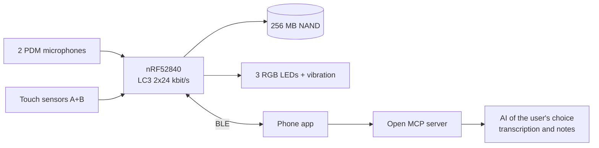
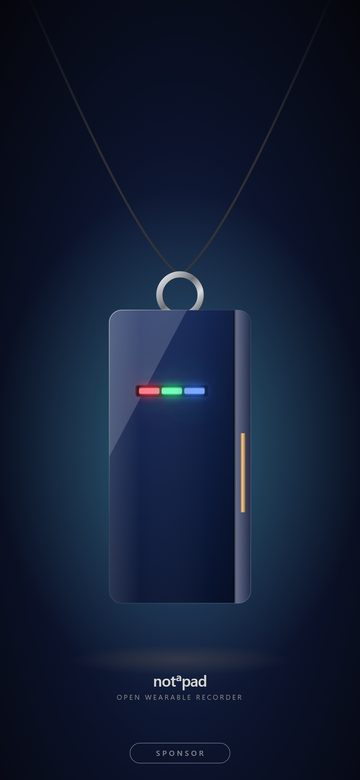
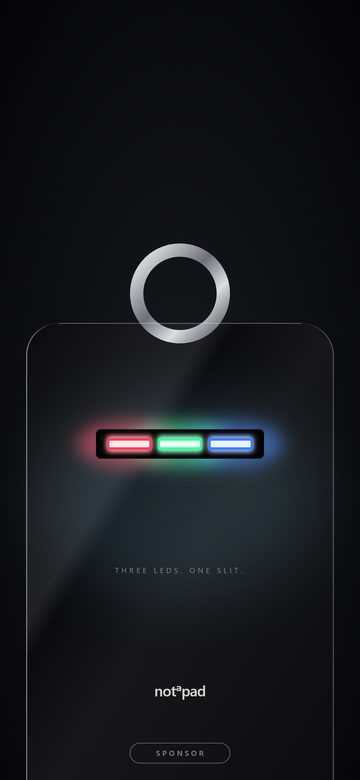
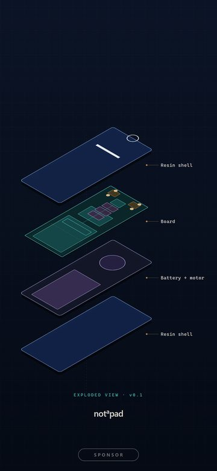
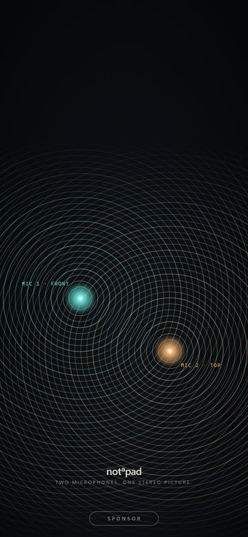

# notªpad

**A DIY wearable AI voice recorder: a resin monolith you wear around your neck. It records your day and leaves transcription and note-taking to the AI of your choice, through an open MCP server.**

 

### [▶ Live animated presentation](https://pzero.github.io/notapad/)

## Contents
- [Overview](#overview)
- [The object](#the-object)
- [Architecture](#architecture)
- [Electronics v0.1](#electronics-v01)
- [Pre-order verification](#pre-order-verification)
- [First firmware and app tests](#first-firmware-and-app-tests)
- [Wallpapers](#wallpapers)
- [Manufacturing](#manufacturing)
- [Status and roadmap](#status-and-roadmap)
- [Looking for sponsors](#looking-for-sponsors)
- [Project history](#project-history)
- [Repository layout](#repository-layout)
- [Contributing](#contributing)
- [License](#license)
- [Authors](#authors)

## Overview
notªpad is a wearable recorder in the spirit of Plaud and Omi, but open. It records all day, syncs over Bluetooth LE with a phone, and hands the audio to an **open MCP server**: transcription, summaries and note organisation are done by the AI the user picks, not by a closed service.

Design goals:
- **Own your data.** Audio and notes stay with the user; the AI is a replaceable component.
- **No screen, no app to open.** Interaction is a squeeze gesture, three LEDs and a vibration motor.
- **Buildable by a small team.** Off-the-shelf parts (an Ebyte E73 nRF52840 module), a 4-layer board assembled by JLCPCB, a resin shell cast in a silicone mould.

> Honest status: this is a design in progress. Nothing has been manufactured yet; the first firmware and app tests (on a development board) have run on a development board (connection, recording, download and transcription work; deeper tests are pending). Figures such as runtime and capacity are estimates.

## The object
| | |
|---|---|
| Size | about 41 × 17.5 × 9 mm (it was 8 mm until 22 Nov; 38 mm is the board length), cast resin |
| Attachment | steel ring cast in with a bushing, so it cannot come off |
| Controls | touch sensors on **both** sides (metal strips as electrodes); a touch counts only when both are active (the "squeeze" gesture), to avoid accidental triggers from the chest |
| Signalling | 3 RGB LEDs behind a 10 mm front slit, vibration motor |
| Audio | 2 PDM microphones: one on the front face, one on the top face next to the ring (via a small channel) |
| Contacts | 4 exposed gold contacts on the back: 5V, GND (charging), SWDIO, SWCLK (firmware over cable in v0.1, later also OTA over BLE). They are also a deliberate aesthetic feature. Pogo pins live in the dock, not on the monolith |

| Back | Side | Finish options |
|---|---|---|
|  |  |  |

## Architecture

The real app and the MCP server are not started yet; a test app for a development board exists (see the roadmap).

## Electronics v0.1
- **Module:** Ebyte E73-2G4M08S1C (nRF52840), wire antenna at the board edge with keep-out.
- **Storage:** W25N02KV QSPI NAND, 256 MB (about 10 to 11 h of stereo LC3 audio).
- **Microphones:** 2x MSM261DGT003 (top-port PDM), stereo on a single data line (L/R pin tied low on one, high on the other).
- **Power:** ~60 mAh LiPo with protection circuit, MCP73832 charger at 50 mA (open-drain status output), 3.3 V LDO, and a P-MOSFET latch that disconnects everything when the battery reaches 3.50 V (idle draw below ~5 uA). The 5V contact re-arms the latch and resets the MCU ("reset by putting it on charge"). A watchdog is always on.
- **Board:** 16.5 x 38 mm, 4 layers, 1.0 mm, ENIG or lead-free HASL (to be fixed at order), components on the top side only. Stackup: F.Cu signals, In1 continuous GND, In2 signals and power, B.Cu signals and GND; antenna keep-out on all layers. Zones: A (0-7 mm: pins, microphone, charger, latch), B (7-20 mm: LEDs, touch ICs, LDO, passives), C (20-38 mm: E73 module and antenna). The motor and battery sit under the board.
- **Battery:** the 60 mAh figure is for the cell planned so far. The 502025, 602030, 401020, 401230 and 402020 cells were ruled out (too wide, too long or too small). The candidate is the 381620 (3.8 x 16 x 20 mm, about 110 mAh, estimate from listings), with protection still to be confirmed; the 501520 does not fit the 9 mm monolith.
- **Estimated consumption:** about 4.6 mA average, about 11.5 h on 60 mAh.

### What changed during design review (21 Nov 2026)
- **Pinout redone.** The E73 does not expose P0.11, P0.14, P0.16, P0.19, P0.21, P0.23, P0.25, P0.27 and P1.01, which the first pinout used. The new assignment is in [`docs/pinout_v0.1.md`](docs/pinout_v0.1.md); the 32 kHz crystal is dropped (firmware uses the internal LFRC).
- **Microphones replaced.** The first choice (LMD3526B261) is bottom-port; the MSM261DGT003 is top-port and in stock at JLCPCB.
- **Space savings.** One resistor per LED on the common anode instead of one per colour (LEDs multiplexed, one colour at a time); an extra 1 uF capacitor on the latch so a reset at low battery does not power the device off.
- **Board closed on 4 layers.** With 2 layers 7 connections stayed open; JLCPCB Economic assembly does not accept 4 layers at 0.8 mm, so the board is 1.0 mm. Length fixed at 38 mm (at 35 mm 4 connections stayed open). Checks: ERC 0, DRC 0 violations, 0 unconnected, schematic-board parity 0.
- **Charger changed to MCP73831** (50 mA), chosen at the time to keep the number of extra-fee components down. *Superseded on 22 Nov by the MCP73832, see the pre-order verification below.*
- **Manufacturing route fixed (late 21 Nov).** JLCPCB only. The XIAO carrier variant costs more than the E73 module, is 17.5 mm wide (as wide as the monolith) and has 13 GPIOs against about 20 needed; home assembly dropped (no hot plate or paste), so JLCPCB assembles every board. No distributor beats LCSC/JLCPCB for the key chips, and a Basic-parts-only board is impossible (no BLE, NAND, PDM microphones, RGB LEDs or touch ICs in that library); 7 extra-fee parts stay. Q2 stays a dual 2N7002DW; NAND and charger stay extra-fee parts.
- **Parts review.** E73 variant with only an external-antenna socket rejected; the 256 MB NAND confirmed after comparing alternatives; microphones rotated by 180 degrees in the JLCPCB placement file (checked in their preview). A NextPCB variant was prepared and dropped for v0 (no microphone stock, higher quote).
- **Charger stays on the monolith** (not in the dock): unpowered contacts outside the dock, CHRG signal available, full 4.2 V charge.

### Update, 22 Nov 2026
- **Licences chosen:** CERN-OHL-S-2.0 for hardware, MIT for software and documents.
- **Presentation animation fixed:** the flicker while the monolith rotates came from the internal battery model sharing a face with the shell (now 15 x 19 x 3.2 mm, 0.2 mm inside). Page layout reworked for phones; group, gesture and MCP scenes redone. Checked at 375, 390 and 1280 px, not on a real iPhone. The monolith length is 41 mm; 38 mm is the board length.
- **Wallpapers approved:** all eight phone wallpapers, published below; the three LEDs are drawn as separate lights.
- **Firmware and app tested on a development board** (see below): connection, recording and download confirmed on a real XIAO nRF52840 Sense; automatic Whisper transcription added to the app; the app stays a PWA also for Android (https page still to publish). Battery 501520 dropped (does not fit 9 mm).
- **Sponsor search started** (see below). Batteries 602030, 401020, 401230 and 402020 ruled out; 381620 is the candidate (estimates).
- **Contacts:** flat-head target contacts (monolith) and single pogo pins (charging base) identified; wiring plan for the base (8 solder joints).
- **Pre-order verification, third run:** 41 passed, 25 warnings, 1 failure, 2 not verifiable (69 tests). Charger changed to the MCP73832; monolith now **9 mm** (at 8 mm only 0.1 mm of resin was left per face, now 0.6 mm); contact targets 2.0 x 4.0 mm with the tip 0.1 mm out of the back, and the four holes widened from 1.0 to 1.1 mm (only the drill files changed, copper identical, DRC clean). The section drawing of the target in the 9 mm monolith is [`verifica/target_sezione.png`](verifica/target_sezione.png) (labels in Italian).

Documents: pinout in [`docs/pinout_v0.1.md`](docs/pinout_v0.1.md); bill of materials and netlist in [`jlc/`](jlc/); KiCad project and generators in [`kicad/`](kicad/).

## Pre-order verification
The board is generated by scripts, which makes mistakes repeatable too. On 22 Nov 2026, before paying for assembly, a reviewer agent went through the whole board with **69 automated tests in 8 areas**:

| Area | What is checked |
|---|---|
| A | Rules, ERC and DRC, also with the ignored rules switched back on |
| B | Pinout of every component against its datasheet |
| C | Schematic symbol against footprint |
| D | Circuit analysis with numbers: latch, reset, dividers, LEDs, LDO, microphones, consumption |
| E | Bill of materials and placement file for JLCPCB: codes, extra-fee parts, rotations |
| F | Mechanics: courtyards, stack-up in the thickness, battery, motor, LEDs in the slit, microphone ports, contacts, antenna keep-out |
| G | Gerber files |
| H | Consistency between documents |

Every value is cross-checked against at least two independent sources (datasheet, the single Python definition, schematic, netlist, board, Gerber, BOM and placement file, documents). Each test is a repeatable script in [`verifica/`](verifica/) that ends in PASS, WARN, FAIL or NOT VERIFIABLE, so the review can be rerun before every order.

**First run:** 37 passed, 26 warnings, 3 failures, 2 not verifiable. **Second run, after the charger fix:** 39 / 26 / 2 / 2. **Third run, after the 9 mm and 1.1 mm hole changes:** 41 passed, 25 warnings, 1 failure, 2 not verifiable. The real problems it found:
- **Charger.** The MCP73831 status output is tri-state and powered from the 5V rail, so it would have pulled an nRF52840 pin to about 5 V, above its maximum. Fixed by switching to the MCP73832: same footprint and pinout, open-drain output, Gerber files unchanged.
- **Assembly tier (open, the one failure left).** JLCPCB lists the E73 module as assemblable only with Standard PCBA, so the 97 EUR Economic quote has to be rechecked before paying.
- **Thickness (fixed).** With the 3 mm module and the 3.8 mm battery, 8 mm left 0.1 mm of resin per face; at 9 mm there is 0.6 mm. Only the shells change.
- **Contact holes (fixed).** The 2.0 x 4.0 mm target contacts need 1.1 mm holes instead of 1.0 mm; only the drill files changed.

What came out clean: ERC and DRC at 0, schematic-board parity 0, empty antenna keep-out. The remaining warnings concern shells, firmware and bring-up, not the board. A review like this cannot replace testing the real boards, and it does not guarantee they will work.

## First firmware and app tests
Started on 22 Nov 2026, before the v0.1 boards arrive. They run on a **Seeed XIAO nRF52840 Sense** with a battery: a development board with the same nRF52840 chip, a PDM microphone and 2 MB of flash, used to try the whole chain early.
- **Firmware** ([`firmware/xiao-prova/`](firmware/xiao-prova/), Arduino with the Bluefruit library): records at 16 kHz, compresses with IMA ADPCM and stores the audio in a ring of 512 sectors of 4 KB, about 4 minutes. At 80% full it asks to sync and the connected app downloads by itself. Each sector is erased only after the app has received it, verified its CRC and saved it. Shutdown at 3.50 V and a watchdog are included.
- **App** ([`app/`](app/)): a web app (PWA), local-only for now (localhost, Web Bluetooth in Edge or Chrome). It stores in the browser (IndexedDB), with playback and WAV export, and no cloud. Since 22 Nov it also **transcribes automatically after each sync** with Whisper running in the browser (transformers.js in a Web Worker, WebGPU or WASM; small model on a PC, base on a phone; Italian), keeping the time of each sentence, with TXT export. The audio never leaves the device. Test: 17 s of Italian speech in 4.8 s with whisper-base on WebGPU.
- **Honest status:** the firmware was flashed on a real XIAO nRF52840 Sense and tested with the app on 22 Nov: Bluetooth connection, recording and audio download work. **Not tested in depth yet:** automatic sync at 80%, audio quality, download speed, the small Whisper model, Edge as an installed app and an Android phone. The final firmware for the v0.1 board (Zephyr is the option) is separate and still on hold; the phone app stays a PWA for now (Flutter postponed).

## Wallpapers
Eight phone wallpapers, all approved. The clock area is kept clear and a discreet "Sponsor" slot sits above the home bar. Each comes as a full-size PNG for iPhone (1179 x 2556) and Android (1080 x 2400); sources and generator scripts are in [`sfondi/`](sfondi/).

|   |   |   |   |
|---|---|---|---|
|  |  |  |  |
| **1. Midnight** [iPhone](https://github.com/PZero/notapad/raw/main/sfondi/png/01_midnight_iphone.png) · [Android](https://github.com/PZero/notapad/raw/main/sfondi/png/01_midnight_android.png) | **2. Macro slit** [iPhone](https://github.com/PZero/notapad/raw/main/sfondi/png/02_macro-slit_iphone.png) · [Android](https://github.com/PZero/notapad/raw/main/sfondi/png/02_macro-slit_android.png) | **3. Gold contacts** [iPhone](https://github.com/PZero/notapad/raw/main/sfondi/png/03_gold-contacts_iphone.png) · [Android](https://github.com/PZero/notapad/raw/main/sfondi/png/03_gold-contacts_android.png) | **4. Exploded view** [iPhone](https://github.com/PZero/notapad/raw/main/sfondi/png/04_exploded-board_iphone.png) · [Android](https://github.com/PZero/notapad/raw/main/sfondi/png/04_exploded-board_android.png) |
|  |  |  |  |
| **5. Two microphones** [iPhone](https://github.com/PZero/notapad/raw/main/sfondi/png/05_two-microphones_iphone.png) · [Android](https://github.com/PZero/notapad/raw/main/sfondi/png/05_two-microphones_android.png) | **6. Ivory** [iPhone](https://github.com/PZero/notapad/raw/main/sfondi/png/06_ivory-light_iphone.png) · [Android](https://github.com/PZero/notapad/raw/main/sfondi/png/06_ivory-light_android.png) | **7. Six finishes** [iPhone](https://github.com/PZero/notapad/raw/main/sfondi/png/07_six-finishes_iphone.png) · [Android](https://github.com/PZero/notapad/raw/main/sfondi/png/07_six-finishes_android.png) | **8. Recording** [iPhone](https://github.com/PZero/notapad/raw/main/sfondi/png/08_recording_iphone.png) · [Android](https://github.com/PZero/notapad/raw/main/sfondi/png/08_recording_android.png) |

## Manufacturing
- **PCB and assembly (v0):** JLCPCB only. Economic PCBA, 4 layers, 1.0 mm, 5 bare boards, 2 assembled; quote 97 EUR for the 2 assembled boards, shipped (estimate until the order is placed). The E73 module was out of stock, so 2 units are pre-ordered into the JLCPCB warehouse; the board order follows their arrival. Production files are generated by script in [`kicad/fab_out/`](kicad/fab_out/).
- **Later batches:** also assembled by JLCPCB (home assembly dropped: no hot plate or paste). Component cost is estimated at about 19 USD per monolith, mostly NAND and module.
- **First programming:** SWD from a Raspberry Pi with OpenOCD (or a Pico debugprobe); the nRF52840 has no ROM bootloader, so the first bootloader goes in over SWD, then updates are OTA over BLE.
- **Shell v0.1:** two SLA half-shells (JLC3DP) filled with low-exotherm epoxy, since JLC does not cast around electronics.
- **Final shell:** SLA master, silicone mould, fully cast pigmented resin.

## Status and roadmap
**Done**
- Test firmware run on a real XIAO nRF52840 Sense (22 Nov): Bluetooth connection, recording and audio download to the app work (16 kHz ADPCM, 4-minute flash ring).
- Automatic on-device-browser transcription in the test app (22 Nov): Whisper via transformers.js, Italian; 17 s transcribed in 4.8 s (base model, WebGPU). Audio does not leave the device.
- All eight wallpapers approved and published (22 Nov).
- Automated pre-order verification (22 Nov): 69 tests in 8 areas, three runs, the last with 41 passed, 25 warnings, 1 failure (assembly tier), 2 not verifiable. Charger corrected to MCP73832; monolith set to 9 mm; contact targets 2.0 x 4.0 mm with 1.1 mm holes.
- Concept, finish renders, animated presentation, BOM and netlist for v0.1.
- Datasheet checks (E73 pinout, microphone port) and the resulting corrections above.
- v0.1 board closed in KiCad: 4 layers, 1.0 mm, 16.5 x 38 mm; ERC 0, DRC 0, no unconnected nets.
- Production files for JLCPCB, PCBWay and ALLPCB in `kicad/fab_out/`.
- Charger first changed to MCP73831, then to MCP73832 after the pre-order review; E73 socket-only variant rejected; NAND confirmed; purchase plan drafted.
- Manufacturing route fixed: JLCPCB only, quote 97 EUR for 2 fully assembled and shipped boards (Economic PCBA, 5 bare boards, 2 assembled). Alternatives dropped: PCBWay, ALLPCB, NextPCB, a Seeed XIAO carrier variant and home assembly.
- Licences chosen (22 Nov): CERN-OHL-S-2.0 hardware, MIT software and documents. Sponsor requests sent; public issue #1 opened as contact channel.

**In progress**
- Deeper tests on the XIAO board and the app: automatic sync at 80%, audio quality, download speed, battery, the small Whisper model, Edge as installed app.
- Android: same app as a PWA on a phone, which needs the page published over https (not done yet).
- Rechecking the JLCPCB quote: the E73 is listed as Standard PCBA only, while the 97 EUR quote assumed Economic. If Economic does not accept it, the quote is redone and may be higher.
- Waiting for sponsor replies; nothing is agreed.
- Waiting for the E73 module: it was out of stock at JLCPCB, so 2 units were pre-ordered through its parts manager to sit in the JLCPCB warehouse. The board order is placed once they arrive (a Black Friday coupon runs until 2 December; timing is not a promise).
- Parts outside JLCPCB: shopping list in `acquisti/spesa_amazon.md` (381620 LiPo candidate, about 110 mAh, an estimate; target contacts and single pogo pins; 0820 coin vibration motor; small epoxy kit; optional SWD probe and magnetic pogo connector), estimated 40 to 60 EUR; whole v0 about 140 to 170 EUR (estimates).

**Next**
1. Settle the assembly quote in the JLCPCB cart and pay once the E73 arrives.
2. Buy the parts outside JLCPCB: 381620 battery with protection, 2.0 x 4.0 mm target contacts, motors, resin.
3. Design the two SLA half-shells at 9 mm (channel for the top microphone, sealed microphone ports, ring bushing); fill in online sponsor forms and prepare a grant application.
4. Bring-up when the boards arrive: power rails, SWD, LEDs, microphones, NAND and touch.
5. Build the charging base.

**On hold by choice (restart after the board)**
- Final firmware for the v0.1 board (Zephyr is the option): LC3, NAND, BLE sync. The test firmware on the XIAO is separate.
- Native phone app (Flutter postponed: the test app stays a PWA, also for Android) and the MCP server.

Working notes (in Italian): [`docs/STATO.md`](docs/STATO.md), [`docs/DECISIONI.md`](docs/DECISIONI.md), [`docs/DOMANDE-APERTE.md`](docs/DOMANDE-APERTE.md).

## Looking for sponsors
We are looking for a sponsor to build the **first 2 to 5 working units**: fabrication and assembly of the boards (top side only), components (nRF52840 modules, SPI NAND, PDM microphones) and the SLA resin shells. This is the step needed before the software phase (firmware, Android app and the open MCP server).

**What sponsors get:** logo and "Sponsored by" credit on this README and on the presentation page, a public build diary with photos, and credit in every post and video.

**Status:** several PCB and component manufacturers were contacted in November 2026; nothing is agreed yet.

**Contact:** [issue #1, "Looking for sponsors: first 2–5 notªpad units"](https://github.com/PZero/notapad/issues/1).

## Project history
Latest milestones (full timeline on the [presentation page](https://pzero.github.io/notapad/#history)):
1. 22 Nov: test firmware run on a real XIAO nRF52840 Sense (connection, recording and download work); the app now transcribes by itself with Whisper in the browser; all eight wallpapers approved and published.
2. 22 Nov: third verification run (41 passed, 1 failure left: assembly tier); charger changed to MCP73832; monolith set to 9 mm; contact holes widened to 1.1 mm.
3. 22 Nov: [group, gesture and MCP scenes redone](https://github.com/PZero/notapad/commit/0ca6206); [page layout reworked for phones](https://github.com/PZero/notapad/commit/7171ea3); [animation flicker fixed](https://github.com/PZero/notapad/commit/09df9c1).
4. 22 Nov: [open licences chosen and sponsor search started](https://github.com/PZero/notapad/commit/a103695).
5. 21 Nov: [manufacturing route fixed](https://github.com/PZero/notapad/commit/1835875), JLCPCB only, 97 EUR quoted for 2 assembled boards; E73 module pre-ordered.

## Repository layout
| Path | Contents |
|---|---|
| `docs/` | project state, decisions, open questions, pinout (working documents, in Italian) |
| `verifica/` | pre-order verification: test scripts and results |
| `jlc/` | bill of materials, netlist, board outline DXF, generator script |
| `kicad/` | KiCad project, LCSC-derived library, generation and routing scripts |
| `render/` | monolith renders and the script that makes them |
| `pagina/` | animated presentation (three.js), published on GitHub Pages, with reduced wallpaper previews |
| `sfondi/` | phone wallpapers: SVG sources, PNG for iPhone and Android, generator scripts |
| `firmware/` | test firmware for the XIAO nRF52840 Sense development board |
| `app/` | test app (local web app, Web Bluetooth) |
| `.claude/` | project agents and commands used to keep documents in sync |
| `CHANGELOG.md` | change history |

## Contributing
Issues and ideas are welcome, especially on the electronics review, enclosure casting and the MCP server design. Please open an issue before a large change. Working documents are in Italian; the README, presentation and changelog are in English.

## License
- **Hardware** (KiCad project, Gerber and fabrication files, enclosure, renders): [CERN-OHL-S-2.0](LICENSE-HARDWARE), strongly reciprocal: modified hardware must stay open.
- **Software** (scripts, firmware, app, MCP server) and documentation: [MIT](LICENSE).
- Third-party symbols and footprints in `kicad/lib/` (generated from LCSC/EasyEDA with easyeda2kicad) keep their original terms.

## Authors
Two friends, as a hobby project.
